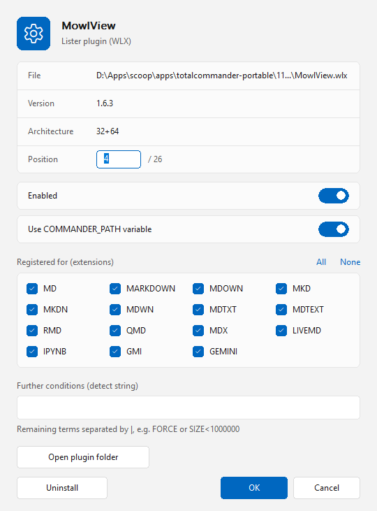

# Plugins

[English](README.md) | **Deutsch**

Ein Plugin-Manager (Dateisystem-Plugin) für den [Total Commander](https://www.ghisler.com), 32 und 64 Bit.
Er zeigt alle Plugins des Total Commanders als Dateien in einem Panel und lässt dich sie installieren, entfernen, aktivieren, deaktivieren und umsortieren, ohne die *Konfiguration* zu öffnen. Nativ, ohne Laufzeitumgebung, außer dem Plugin muss nichts installiert werden.

## Aufbau

*Plugins* öffnest du über die Netzwerkumgebung bzw. die Liste der Dateisystem-Plugins.

- Ein Ordner pro Plugin-Typ: Lister, Packer, Inhalt, Dateisystem.
- Jedes Plugin ist eine Datei. Lister- und Inhalts-Plugins tragen ihre Ladereihenfolge als Zahl (`01`, `02`, …); deaktivierte Plugins sind mit „(aus)“ markiert und stehen am Ende.
- Das Panel öffnet sich in einer Spaltenansicht mit Name, Status und „Registriert für“ (Endungen eines Packers, Detect String der übrigen). Weitere Spalten für eigene Ansichten (*Benutzerdefinierte Spalten*, Plugin „Plugins“): Position, Typ, Architektur, Pfad, Version, Beschreibung.

## Aktionen

- **Installieren:** eine Plugin-Datei (`.wlx`, `.wcx`, `.wdx`, `.wfx`, auch die 64-Bit-Varianten) oder ein ZIP/7z mit `pluginst.inf` ins Panel kopieren (F5/F6, Drag & Drop), in die Wurzel oder in einen der Ordner – der Typ wird aus der Datei gelesen. Plugins fragt vorher nach und lehnt Plugins ab, die nur in der anderen Bit-Breite als der Total Commander vorliegen. Die Dateien landen im Plugin-Ordner des Total Commanders und das Plugin wird registriert (Lister: der Detect String wird aus dem Plugin gelesen, Packer: Endungen aus `pluginst.inf` oder werden erfragt). Eine Plugin-Datei, die der Total Commander geladen hat, lässt sich nicht überschreiben; die alte Datei wird daher in *Name*`.old` umbenannt und die neue daneben geschrieben. Die `.old`-Datei wird beim nächsten Laden von Plugins gelöscht.
- **Deinstallieren:** Entf, oder die Schaltfläche *Deinstallieren* in den Eigenschaften (Enter). Das Plugin wird abgemeldet und sein Ordner in den Papierkorb verschoben.
- **Aktivieren / Deaktivieren:** Alt+Enter. Ein deaktiviertes Plugin bleibt in `[DisabledPlugins]` und kehrt an seinen Platz zurück, wenn du es wieder aktivierst.
- **Reihenfolge ändern:** in den Eigenschaften (Enter) die Pfeil-Buttons neben der Position benutzen (oder die Tasten Hoch und Runter), die neue Position eintippen, oder den Eintrag umbenennen (Umschalt+F6) und die Zahl am Anfang ändern, zum Beispiel `05 Synta` in `01 Synta`. Nur Lister- und Inhalts-Plugins haben eine Reihenfolge.
- **Eigenschaften** (Enter): bei Lister- und Inhalts-Plugins werden die Endungen des Detect Strings als Kontrollkästchen angezeigt, zusammen mit denen, die das Plugin selbst vorschlägt; an- oder abhaken, *Alle* / *Keine* benutzen. Andere Teile des Detect Strings (`FORCE`, `SIZE<…`, Gruppen) bleiben unverändert in einem Feld darunter. Bei Packern sind die Kontrollkästchen die Endungen, für die der Packer registriert ist; eine Endung, die ein anderer Packer benutzt, wechselt zu diesem.
- Derselbe Dialog hat einen Schalter *Pfad mit %COMMANDER_PATH% speichern*: der Plugin-Pfad wird als `%COMMANDER_PATH%\plugins\…` (portabel) oder als absoluter Pfad gespeichert.
- **Info** in der Wurzel zeigt den Über-Dialog, **Einstellungen** öffnet die Einstellungen: Darstellung (Auto / Hell / Dunkel), Sprache (Auto / Deutsch / English), ob neue Plugins mit `%COMMANDER_PATH%` gespeichert werden, und die Benachrichtigungen – vor dem Installieren fragen, Bestätigung nach erfolgreicher Installation, vor dem Löschen fragen, Bestätigung nach dem Löschen.

Änderungen werden in `wincmd.ini` geschrieben (und in die Datei, auf die sie die Plugin-Abschnitte umleitet); eine Kopie der vorherigen Datei bleibt als `*.plugins-bak` erhalten. Der Total Commander übernimmt sie nach einem Neustart.

Helles und dunkles Design im Windows-11-Stil, Oberfläche auf Deutsch und Englisch (folgt der Windows-Sprache).

## Download und Installation

1. **`Plugins.zip`** vom [neuesten Release](https://github.com/naderi/tc-plugins/releases/latest) herunterladen.
2. Das ZIP im Total Commander öffnen (Enter auf der Datei) und die Frage nach der Installation des Plugins bestätigen.

Voraussetzung: Total Commander 32 oder 64 Bit unter Windows 10 oder 11. Die Einstellungen stehen in `fsplugin.ini` neben `wincmd.ini`, Abschnitt `[Plugins]` (`Theme`, `Language`, `StorePathWithVariable`, `AskBeforeInstall`, `MessageAfterInstall`, `AskBeforeUninstall`, `MessageAfterUninstall`).

## Lizenz

Freeware – frei nutzbar, aber **nicht zum Verkauf**. Siehe [LICENSE](LICENSE).

## Unterstützung

Wenn Plugins dir Zeit spart, kannst du die Entwicklung auf Ko‑fi unterstützen. ☕

---

© 2026 [Ali Naderi](https://github.com/naderi) · [digitalent.dev](https://digitalent.dev/de/)
