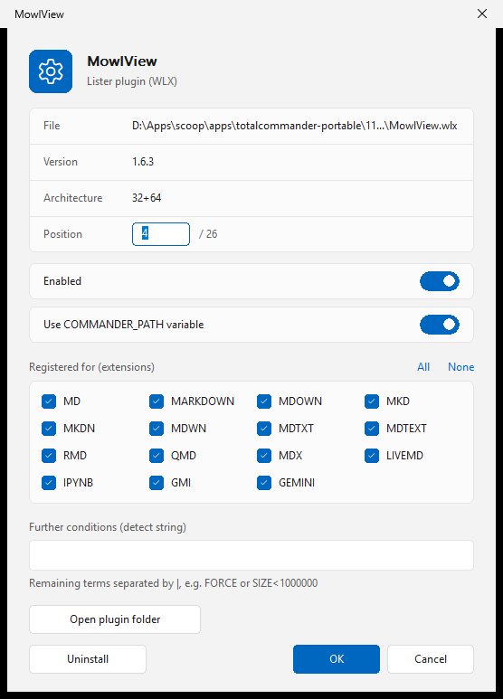

# Plugins

**English** | [Deutsch](README.de.md)

A plugin manager (file system plugin) for [Total Commander](https://www.ghisler.com), 32 and 64 bit.
It shows all of Total Commander's plugins as files in a panel and lets you install, remove, enable, disable and reorder them without opening *Configuration*. Native, no runtime, nothing to install besides the plugin.

## Layout

Open *Plugins* from Network Neighborhood / the file system list.

- One folder per plugin type: Lister, Packer, Content, File system.
- Every plugin is a file. Lister and content plugins carry their load order as a number (`01`, `02`, …); disabled plugins are marked "(off)" and listed last.
- The panel opens in a column view with Name, Status and "Registered for" (extensions of a packer, detect string of the others). Further columns for your own views (*Configure custom columns*, plugin "Plugins"): Position, Type, Architecture, Path, Version, Description.

## Actions

- **Install:** copy a plugin file (`.wlx`, `.wcx`, `.wdx`, `.wfx`, also the 64-bit variants) or a ZIP/7z with `pluginst.inf` into the panel (F5/F6, drag and drop), in the root or in any of its folders – the type is taken from the file. Plugins asks first and refuses plugins that exist only in the other bit width than Total Commander. Files go to the plugin folder of Total Commander and the plugin is registered (lister: the detect string is read from the plugin, packer: extensions from `pluginst.inf` or asked for). A plugin file that Total Commander has loaded cannot be overwritten, so the old file is renamed to *name*`.old` and the new one is written next to it; the `.old` file is deleted the next time Plugins is loaded.
- **Uninstall:** Delete, or the *Uninstall* button in the properties (Enter). The plugin is unregistered and its folder moved to the Recycle Bin.
- **Enable / disable:** Alt+Enter. A disabled plugin stays in `[DisabledPlugins]` and returns to its place when enabled again.
- **Reorder:** in the properties (Enter) type the new position, or rename the entry (Shift+F6) and change the number at the start, for example `05 Synta` to `01 Synta`. Only lister and content plugins use an order.
- **Properties** (Enter): for lister and content plugins the extensions of the detect string are shown as check boxes together with the ones the plugin proposes itself; tick or untick them, use *All* / *None*. Other terms of the detect string (`FORCE`, `SIZE<…`, groups) stay as they are in a field below. For packers the check boxes are the extensions the packer is registered for; an extension that another packer uses moves over to this one.
- The same dialog has a switch *Use COMMANDER_PATH variable*: the plugin path is stored as `%COMMANDER_PATH%\plugins\…` (portable) or as an absolute path.
- **Info** in the root shows the about dialog, **Settings** opens the settings: theme (automatic / light / dark), language (automatic / German / English), whether new plugins are stored with `%COMMANDER_PATH%`, and the notifications – ask before installing, confirmation after a successful installation, ask before deleting, confirmation after deleting.

Changes are written to `wincmd.ini` (and the file it redirects the plugin sections to); a copy of the previous file is kept as `*.plugins-bak`. Total Commander applies them after a restart.

Light and dark design in the Windows 11 look, English and German user interface (follows the Windows language).

## Download and installation

1. Download **`Plugins.zip`** from the [latest release](https://github.com/naderi/tc-plugins/releases/latest).
2. Open the ZIP in Total Commander (Enter on the file) and confirm the question whether to install the plugin.

Requires Total Commander 32 or 64 bit on Windows 10 or 11. Settings are stored in `fsplugin.ini` next to `wincmd.ini`, section `[Plugins]` (`Theme`, `Language`, `StorePathWithVariable`, `AskBeforeInstall`, `MessageAfterInstall`, `AskBeforeUninstall`, `MessageAfterUninstall`).

## License

Freeware – free to use, but **not for sale**. See [LICENSE](LICENSE).

## Support

If Plugins saves you time, you can support its development on Ko‑fi. ☕

---

© 2026 [Ali Naderi](https://github.com/naderi) · [digitalent.dev](https://digitalent.dev/en/)
