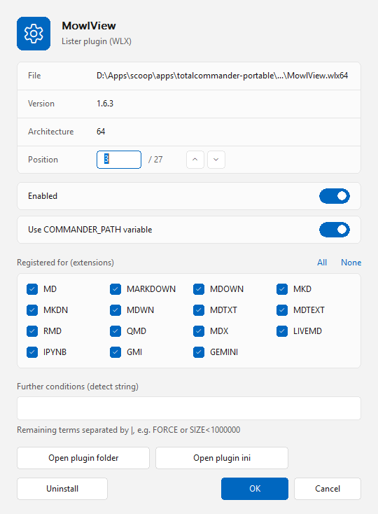
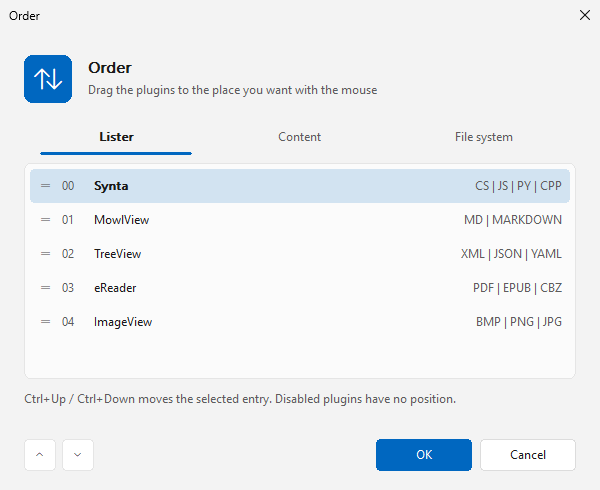

# Plugins

**English** | [Deutsch](README.de.md)

A plugin manager (file system plugin) for [Total Commander](https://www.ghisler.com), 32 and 64 bit.
It shows all of Total Commander's plugins as files in a panel and lets you install, remove, enable, disable and reorder them without opening *Configuration*. Native, no runtime, nothing to install besides the plugin.

## Layout

Open *Plugins* from Network Neighborhood / the file system list.

- Two views (setting *View*): **Grouped** (default) with one folder per plugin type – Lister, Packer, Content, File system – or **List** with all plugins in one list. In the list the names start with the type (`WLX 00 Synta`, `WCX 7-Zip`, `WDX …`, `WFX …`), so it can be sorted by name (by type, then by number) or by the *Type* column, and reordering works as in the folders.
- The main folder also holds the folder **By extension** and the entries **Order** and **Settings** (each can be hidden in the settings).
- Every plugin is a file. Lister, content and file system plugins carry their order as a number (`00`, `01`, … as in `wincmd.ini`); disabled plugins are marked "(off)" and listed last.
- The panel opens in a column view with Name, Index (the position, narrow, next to the name), Status, "Registered for" (extensions of a packer, detect string of the others) and Version. Further columns for your own views (*Configure custom columns*, plugin "Plugins"): Type, Architecture, Path, Description.

## Actions

- **Install:** copy a plugin file (`.wlx`, `.wcx`, `.wdx`, `.wfx`, also the 64-bit variants) or a ZIP/7z with `pluginst.inf` into the panel (F5/F6, drag and drop), in the root or in any of its folders – the type is taken from the file. Plugins asks first and refuses plugins that exist only in the other bit width than Total Commander. Files go to the plugin folder of Total Commander and the plugin is registered (lister: the detect string is read from the plugin, packer: extensions from `pluginst.inf` or asked for). A plugin file that Total Commander has loaded cannot be overwritten, so the old file is renamed to *name*`.old` and the new one is written next to it; the `.old` file is deleted the next time Plugins is loaded.
- **Uninstall:** Delete, or the *Uninstall* button in the properties (Enter). The plugin is unregistered and its folder moved to the Recycle Bin.
- **Enable / disable:** Ctrl+Del on the entry under the cursor (setting *Ctrl+Del enables / disables the plugin under the cursor*, on by default) or the switch in the properties; the cursor follows the entry to its new place. A disabled plugin stays in `[InactivePlugins]` and returns to its place when enabled again.
- **Reorder:** in the properties (Enter) use the arrow buttons next to the position (or the Up and Down keys), type the new position, or rename the entry (Shift+F6) and change the number at the start, for example `05 Synta` to `01 Synta`. Lister, content and file system plugins use an order (for file system plugins it is the order of the entries in wincmd.ini; Total Commander 11.5 still shows them sorted by name in Network Neighborhood); packers do not. Optionally (setting "Up / Down with a key combination moves lister, content and file system plugins", off by default) Ctrl+Alt+Up / Ctrl+Alt+Down moves the entry under the cursor by one place directly in the panel and the cursor follows it; this works in the Lister, Content and File system folders and in the list view. The name under the cursor is read from the file list, so neither the clipboard nor the command line is touched and the key works with a hidden command line too. Alt+Up / Alt+Down is "Directory History" in Total Commander, so the key combination is yours to choose: in the settings tick Ctrl, Alt and Shift as you like (at least Ctrl or Alt), or set `ReorderKeys` in `fsplugin.ini`, for example `ReorderKeys=Ctrl+Shift+Alt`. The **order window** (the entry *Order* in the main folder, the word `order` in the command line, or the *Open* button in the settings, tab Order) shows the enabled lister, content and file system plugins in one list per type: drag an entry with the mouse to its new place (or select it and press Ctrl+Up / Ctrl+Down); *OK* writes the new order.
- **By extension:** the folder *By extension* lists every extension some plugin is registered for (EXT terms of lister and content plugins, extensions of packers); in an extension folder, for example `\By extension\bmp`, are the plugins that handle it, named like in the list view (`WLX Name`, `WCX Name`), disabled ones marked "(off)". You can also type the path (`cd \By extension\xls`). Enter opens the properties of the plugin as usual. Plugins whose detect string has no `EXT="..."` term (for example only `MULTIMEDIA`) are not found there.
- **Properties** (Enter): for lister and content plugins the extensions of the detect string are shown as check boxes together with the ones the plugin proposes itself; tick or untick them, use *All* / *None*. Other terms of the detect string (`FORCE`, `SIZE<…`, groups) stay as they are in a field below. For packers the check boxes are the extensions the packer is registered for; an extension that another packer uses moves over to this one. Right-click an extension to set its packer parameters (the capability flags of Total Commander's packer configuration, such as *Can create new archives*, *Can delete files*, *Detects archive type by content*); *Default* restores the values the plugin reports itself.
- The same dialog has a switch *Use COMMANDER_PATH variable*: the plugin path is stored as `%COMMANDER_PATH%\plugins\…` (portable) or as an absolute path.
- **Settings and Info:** right-click *Plugins* in Network Neighborhood and choose *Properties…* (five tabs: Appearance, Installation, Notifications, Order, Info): theme (automatic / light / dark / like Total Commander), language (automatic / German / English), the view (grouped / list), whether the list view shows the type (`WLX`, `WCX`, …) and the position number before the name (the number is also in the *Index* column, which sits next to the name in the default column view), whether new plugins are stored with `%COMMANDER_PATH%`, whether only the files matching Total Commander's bit width are copied (32 or 64 bit), a *Clean up* button that moves unused 32/64-bit files of registered plugins to the Recycle Bin, and the notifications – ask before installing, confirmation after a successful installation, ask before deleting, confirmation after deleting – and the keyboard reordering (switch plus the keys Ctrl, Alt and Shift, at least Ctrl or Alt) and the Ctrl+Del switch. The tab Order also has the switches that show or hide the entry *Order* and the folder *By extension* in the main folder. The entry *Settings* in the main folder opens the same window (it can be hidden in the Appearance tab), and so does Alt+Enter on `[..]`. The *Open plugin ini* button uses the editor set in Total Commander; `OpenIniCommand` in `fsplugin.ini` replaces it (read again at every click, no restart of Total Commander needed) (`%1` is the file, for example `"C:\Tools\Notepad++\notepad++.exe" "%1"`; `system` is the Windows default program).

Changes are written to `wincmd.ini` (and the file it redirects the plugin sections to); a copy of the previous file is kept as `*.plugins-bak`. Total Commander applies them after a restart.

Light and dark design in the Windows 11 look, English and German user interface (follows the Windows language).

## Download and installation

1. Download **`Plugins.zip`** from the [latest release](https://github.com/naderi/tc-plugins/releases/latest).
2. Open the ZIP in Total Commander (Enter on the file) and confirm the question whether to install the plugin.

Requires Total Commander 32 or 64 bit on Windows 10 or 11. Settings are stored in `fsplugin.ini` next to `wincmd.ini`, section `[Plugins]` (`Theme`, `Language`, `View`, `ListShowType`, `ListShowNumber`, `StorePathWithVariable`, `OnlyOwnBitness`, `AskBeforeInstall`, `MessageAfterInstall`, `AskBeforeUninstall`, `MessageAfterUninstall`, `ReorderHotkey`, `ReorderKeys`, `ToggleHotkey`, `ShowSettingsEntry`, `ShowOrderEntry`, `ShowExtensionFolder`, `OpenIniCommand`).

### Updating

Total Commander keeps a file system plugin loaded until it exits, so Plugins.wfx / Plugins.wfx64 cannot be overwritten while Total Commander is running (leaving the plugin's panel does not help). Either close Total Commander and install the new version, or rename the loaded file (for example to `Plugins.wfx64.old`), copy the new one next to it and restart Total Commander. Windows allows renaming a loaded DLL; delete the `.old` file afterwards.

## Languages

Plugins speaks English, German, Spanish, French, Russian, Ukrainian, Chinese (Simplified), Hindi, Portuguese and Persian. It follows the Windows display language; to pick another one, use the plugin's settings (*Language*) or set `Language=<name or code>` in the `[Plugins]` section of `fsplugin.ini` (for example `Persian` or `fa`; `auto` follows Windows, `tc` follows Total Commander's own language – also the entry *Like Total Commander*).

The texts are plain `.lng` files in the `Languages` folder. To add a language, copy `Languages\Template.lng`, translate the right-hand sides and save it under a new name – it appears in the language list.

Corrections and new translations from native speakers are very welcome – please send them as an [issue](https://github.com/naderi/tc-plugins/issues) on this repository.

## License

Freeware – free to use, but **not for sale**. See [LICENSE](LICENSE).

## Support

If Plugins saves you time, you can support its development on Ko‑fi. ☕

---

© 2026 [Ali Naderi](https://github.com/naderi) · [digitalent.dev](https://digitalent.dev/en/)
